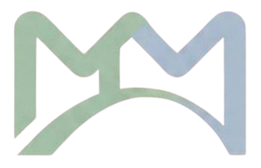

<div align="center">

  

  #  Proyecto DobleM

  **Asignaturas:** Metodologías de Desarrollo Ágil (MDA) & Dirección y Gestión de Proyectos (DGP)  
  **Universidad de Granada (UGR)**

  [](https://www.latex-project.org/)
  [](https://github.com/)
  [](https://www.atlassian.com/software/jira)

</div>

---

## 📌 Visión General del Proyecto

**DobleM** es una solución desarrollada de forma colaborativa para aplicar los principios de la gestión de proyectos de software, desarrollo ágil (Scrum/Kanban) y estandarización de procesos de calidad.

---

## 👥 Equipo de Trabajo y Roles

| Miembro | Asignatura | Rol |
| :--- | :---: | :--- |
| **Minerva Cebrián Marín** | MDA & DGP |  **Gestora de Calidad** |
| **Pedro Javier Pérez Jiménez** | MDA & DGP |  **Gestor de Accesibilidad** |
| **Ángela García Olmos** | MDA & DGP | 
| **Daniel Vega Jiménez** | MDA & DGP |
| **Cristina García Gázquez** | Solo DGP |
| **Jorge García Gámiz** | Solo MDA | 

> 🔄 *Nota:* El rol de **Coordinador** es rotatorio según la fase del proyecto.

---

## 🎨 Guía de Estilo y Paleta de Colores (LaTeX)

Para garantizar la coherencia tipográfica y visual en todas las memorias oficiales, se ha definido una paleta institucional en el archivo `main.tex`:

| Muestra | Nombre en LaTeX | Código HEX | Uso en Documentación |
| :---: | :--- | :--- | :--- |
| 🟩 | `verdeApagado` | `#A4BEA7` | Destacados y acentos primarios |
| 🟦 | `azulPastelApagado` | `#ABBBCB` | Cabeceras de tablas y secciones |
| 🩵 | `azulclaro` | `#D1DBE4` | Fondos de bloques e indicadores |

---

## 📁 Arquitectura del Repositorio

```mermaid
graph TD
    A[🚀 DobleM] --> B[main.tex]
    A --> C[📁 cap/]
    A --> D[📁 img/]

    C --> C1[portada.tex]
    C --> C2[personas.tex]
    C --> C3[roles.tex]

    D --> D1[logo.png]
    D --> D2[Fondo_Portada.png]
    D --> D3[ugr.png]

    %% Estilos institucionales
    style A fill:#A4BEA7,stroke:#333,stroke-width:2px,color:#000
    style C fill:#ABBBCB,stroke:#333,stroke-width:1px,color:#000
    style D fill:#ABBBCB,stroke:#333,stroke-width:1px,color:#000